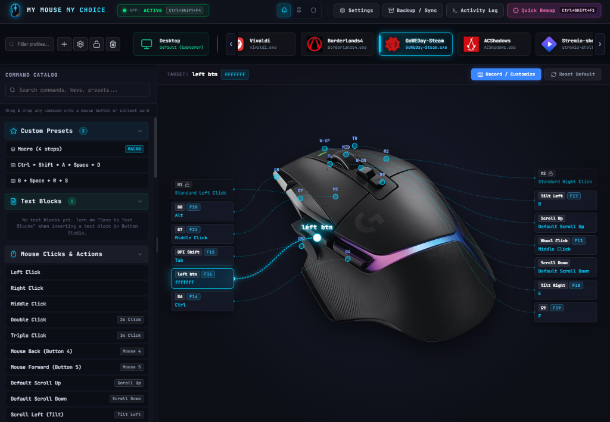
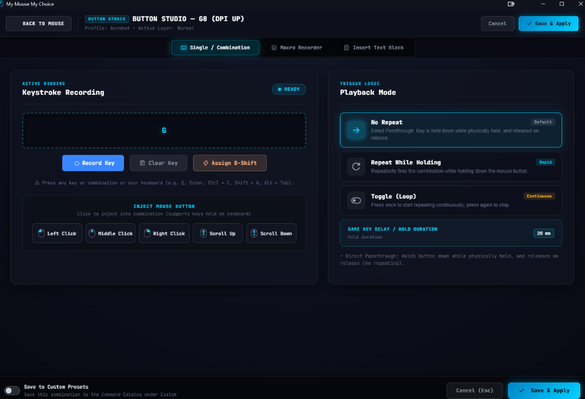
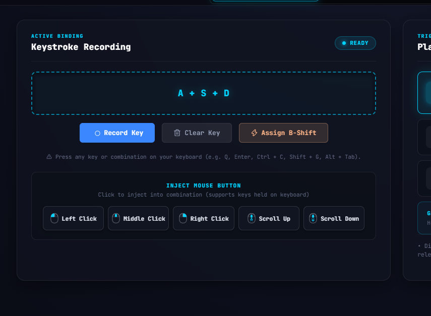

# My Mouse My Choice — Advanced Mouse & Macro Manager

A lightweight, zero-bloat universal control center and macro execution suite for multi-button mice, combining onboard hardware memory with **AutoHotkey v2**, a low-level **Interception Kernel Driver**, and a modern **WebView2** interface.

---

## 📸 Screenshots

### Main Studio Dashboard

### Button Studio & Macro Engine

### Keystroke Recording & Direct Mouse Injection

---

## ⚡ The Architecture: Why This Setup?

1. **Zero Background Bloat**: Replaces heavy proprietary manufacturer software suites running dozens of background services and telemetry. You configure your mouse's onboard hardware memory **once** with virtual keys (`F13`–`F24`), then close the manufacturer utility forever.
2. **Universal Compatibility**: Works with any mouse featuring onboard hardware memory or programmable buttons (such as Logitech, Razer, SteelSeries, Corsair, and custom mice).
3. **Infinite Flexibility**: AHK v2 intercepts the mouse's virtual keys (`F13`–`F24`), enabling:
   - **B-Shift Secondary Layer**: Holding a designated modifier button unlocks a second layer of actions for every button and the scroll wheel.
   - **Automatic Per-App Profiles**: Instant profile switching when bound applications receive window focus or mouse hover, complete with customizable On-Screen Display (OSD) notifications.
   - **Button Studio & Macro Sequencer**: Create single key combinations, text snippet blocks, or multi-step macros supporting **No Repeat**, **Repeat While Holding**, **Toggle**, and **Sequence** (distinct actions On Press, While Holding, and On Release).
   - **Live Hardware Monitor**: Real-time visual dashboard with dynamic SVG leader lines and hotspots that illuminate when mouse buttons are pressed.
   - **Hardware Key Injector Assistant**: Built-in countdown injector solves the problem of physical keyboards lacking `F13`–`F24` keys when pairing buttons in onboard memory software.
   - **Interactive Pointer Calibrator**: Visual editor to reposition button callout lines or upload custom mouse images and layouts.

---

## 🛡️ Interception Kernel Driver Mode (Hardware-Level Injection)

*My Mouse My Choice* features an optional low-level **Interception Kernel Driver** integration (`mouclass.sys` & `kbdclass.sys` filter drivers):

* **Pure Hardware-Level Events (`flags = 0`):**
  Standard Windows user-mode injection APIs (`SendInput`, `mouse_event`) mark synthetic events with `LLMHF_INJECTED (0x01)` and `LLKHF_INJECTED (0x10)`. The Interception driver dispatches inputs directly through the kernel input stack with `flags = 0`, making them indistinguishable from physical hardware switches.
* **Elevated Windows & UIPI Bypass:**
  Standard user-mode scripts cannot interact with elevated windows (Task Manager, Registry Editor, UAC dialogs). The kernel driver dispatches at the ring-0 level, operating seamlessly across all windows regardless of integrity level.
* **Raw Input & Anti-Cheat Compatibility:**
  Bypasses user-mode hooks and synthetic input blocks in competitive games, raw input handlers, and direct device polling.
* **Smart Elevation (Zero UAC Prompts by Default):**
  * When Kernel Driver Mode is turned **OFF**, the app starts quietly as a standard non-elevated user—**no UAC prompt appears on boot**.
  * When you toggle **Enable Kernel Mode** inside Studio Settings, the app offers an in-app confirmation dialog and elevates cleanly.
* **Silent Windows Startup:**
  When both Startup and Kernel Driver modes are active, the app registers a Windows Task Scheduler job (`/rl highest`), enabling silent elevated auto-launch at Windows logon **with zero UAC prompts**.

---

## 🖱️ Hardware Button Virtual Key Matrix

| Button Position | Typical Function | Hardware Virtual Key | Default Action (Desktop) | B-Shift Action (Hold Modifier) |
| :---: | :--- | :---: | :--- | :--- |
| **Middle Click** | Wheel Click (Mouse 3) | `F13` | Default Middle Click (`{MButton}`) | Close Active Tab (`Ctrl+W`) |
| **Back Button** | Side Back (Mouse 4) | `F14` | Browser Back (`Alt+Left`) | Reopen Closed Tab (`Ctrl+Shift+T`) |
| **B-Shift Modifier** | Thumb Paddle / Modifier | `F15` | **Hold:** Secondary Layer Modifier | Secondary Layer Modifier |
| **Forward Button** | Side Forward (Mouse 5) | `F16` | Browser Forward (`Alt+Right`) | Close Active Tab (`Ctrl+W`) |
| **Tilt Left** | Wheel Tilt Left | `F17` | Previous Tab (`Ctrl+Shift+Tab`) | Snap Window Left (`Win+Left`) |
| **Tilt Right** | Wheel Tilt Right | `F18` | Next Tab (`Ctrl+Tab`) | Snap Window Right (`Win+Right`) |
| **Profile Cycle** | Top Button / Selector | `F19` | Cycle Profiles | Cycle Profiles |
| **Extra Button 1** | DPI Up / Top Index | `F20` | Volume Up | Maximize Window (`Win+Up`) |
| **Extra Button 2** | DPI Down / Top Index | `F21` | Volume Down | Minimize Window (`Win+Down`) |
| **Scroll Wheel Up / Down** | Scroll Wheel | Standard | Normal Scrolling | **Fine Volume Control** (when B-Shift held) |
| **Custom Buttons** | Additional Grid / Side Keys | `F22`–`F24` | User Defined | User Defined |

---

## 🚀 Quick Setup Guide

### Step 1: Launch the Studio
Launch **`MyMouseMyChoice.exe`** (or run `MyMouseMyChoice.ahk`). The modern Studio interface will open.

### Step 2: Open Your Mouse Hardware Memory Utility
Open your mouse manufacturer's lightweight onboard memory tool (for example, Logitech Onboard Memory Manager `OMM.exe`, Razer Synapse onboard memory profile, or similar software).

### Step 3: Pair Virtual Keys with the Built-in Injector
1. In the Studio settings, click **"Hardware Memory Setup"** (or use the built-in pairing assistant).
2. In your mouse software, select a button and choose **Keystroke &rarr; Record**.
3. In the Studio pairing modal, click the corresponding **"Inject Key"** button — a 3-second countdown will start with audio beeps.
4. Click into your mouse software's keystroke record field during the countdown. The virtual `F13`–`F24` key will be automatically injected.
5. Save the profile to your mouse's **Onboard Hardware Slot**.
6. Close the manufacturer software. You will never need to open it again!

---

## 🎛️ Profiles & Macro Engine

- **Desktop**: Fast tab switching, window snapping, media volume, and task view.
- **Productivity & Code**: Code navigation, command palettes, line duplication, document formatting, undo/redo.
- **Gaming & Turbo**: Rapid-Fire auto-clicker, sniper steady aim, slot switching, and sequence macros.
- **Media**: Track skip, volume control via scroll wheel, play/pause, scrub forward/rewind.
- **Auto-Switching**: Binds profiles to one or more executables (e.g. `vivaldi.exe, chrome.exe`). Profiles switch automatically when windows gain focus or cursor hovers over them.
- **Macro Sequencer**:
  - **No Repeat**: Executes the action or macro sequence once upon button press.
  - **Repeat While Holding**: Automatically loops actions at customizable millisecond intervals while held.
  - **Toggle**: Toggles looping actions ON/OFF with each button click.
  - **Sequence**: Executes distinct actions **On Press**, **While Holding** (looped), and **On Release**.

---

## 📁 Project Structure

- `MyMouseMyChoice.ahk` — Core application script, hardware hotkeys, system tray menu, and IPC dispatcher.
- `lib/Profiles.ahk` — Dynamic profile engine, macro sequencer, and settings persistence.
- `lib/InterceptionDriver.ahk` — Low-level kernel filter driver controller and hardware event dispatcher.
- `lib/StartupManager.ahk` — Silent Windows startup and boot auto-launch controller (supporting Task Scheduler `/rl highest`).
- `lib/WebViewGuiManager.ahk` — Embedded Microsoft Edge WebView2 GUI manager and bidirectional IPC bridge.
- `lib/GuiManager.ahk` — Native AHK secondary fallback interface and button studio.
- `lib/OMMHelper.ahk` — Virtual key injection assistant for onboard memory pairing.
- `lib/OSD.ahk` — On-screen display HUD notifications (standard text and compact icon modes).
- `lib/QuickRemap.ahk` — Fast in-app key remapping listener.
- `web/index.html` — Studio workspace, interactive mouse stage, button callouts, and modals.
- `web/style.css` — Modern Cyber Slate & Obsidian design system.
- `web/app.js` — Client-side UI logic, SVG leader line rendering, macro drag-and-drop, and catalog drawer.
- `settings.ini` — User profiles, button assignments, hardware F-key mappings, and macro sequences.
- `build.bat` — One-click compilation pipeline building `MyMouseMyChoice.exe` and Inno Setup installer.

---

## 🔨 Building from Source

To compile the standalone binary and installer:
1. Run `build.bat` from the root directory.
2. The pipeline compiles `MyMouseMyChoice.ahk` into `MyMouseMyChoice.exe` using `tools/Compiler/Ahk2Exe.exe`.
3. If Inno Setup 6 is installed, `dist/MyMouseMyChoice_Setup_v2.0.exe` is generated automatically.
